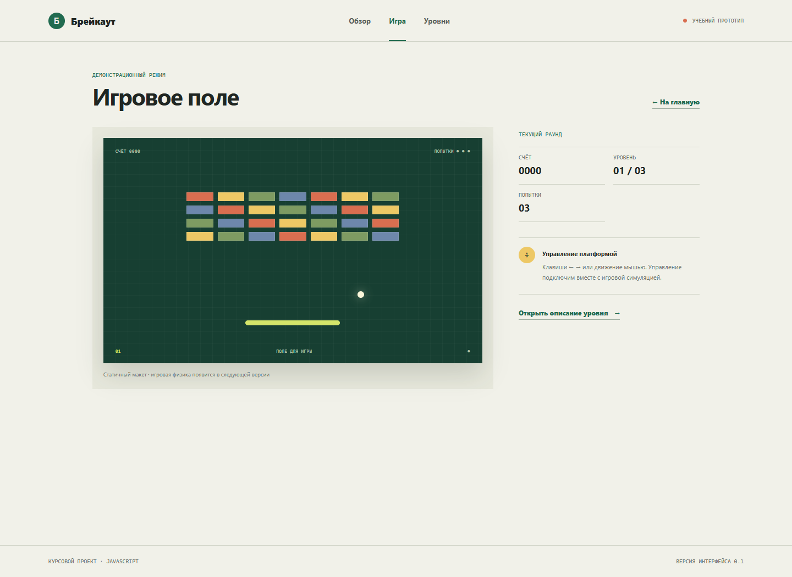

# Брейкаут

Учебный проект по теме «Разработка игры „Брейкаут“ с уровнями и моделью физики на языке JavaScript». Репозиторий содержит архитектуру курсового приложения, требования к MVP и TypeScript-каркас на React. На текущем этапе страницы и игровое поле демонстрационные: движение мяча, столкновения и счёт ещё не реализованы.

## Структура

- `apps/web` — браузерное приложение с главной страницей, страницей игры и страницей уровня.
- `packages/ui-components` — библиотека общих React-компонентов, используемая приложением.
- `architecture.md` — проекты, компоненты, библиотеки и маршруты.
- `mvp.md` — сценарий использования и границы первой версии игры.

## Требования

- Node.js 20.19 или новее.
- npm 10 или новее.

## Запуск

Из корня репозитория установите зависимости и соберите проекты:

```sh
npm install
npm run build
```

Запустите приложение:

```sh
npm run dev
```

Vite напечатает локальный адрес приложения. Основные команды из корня:

```sh
npm run lint
npm run test
npm run test:coverage
npm run build
```

Оба проекта также имеют собственные команды `dev`, `build`, `lint`, `lint:fix`, `test` и `test:coverage`. Чтобы запустить команду для одного проекта, используйте `npm run <команда> --workspace @breakout/web` или `npm run <команда> --workspace @breakout/ui-components`.

## Примеры интерфейса

Главная страница:


Страница игрового прототипа:



Снимки показывают каркас интерфейса; они не являются подтверждением реализованной игровой физики.

## Маршруты

- `/` — обзор проекта и переход к прототипу.
- `/game` — демонстрационная игровая страница.
- `/levels/:levelId` — описание выбранного уровня.
- остальные адреса — страница 404.

## Проверки

В библиотеке общих компонентов есть модульные тесты для кнопки и статусного показателя. Порог покрытия библиотеки установлен не ниже 70% по ветвлениям, функциям, строкам и операторам. Приложение проверяет рендер основных маршрутов и страницы неизвестного адреса.
