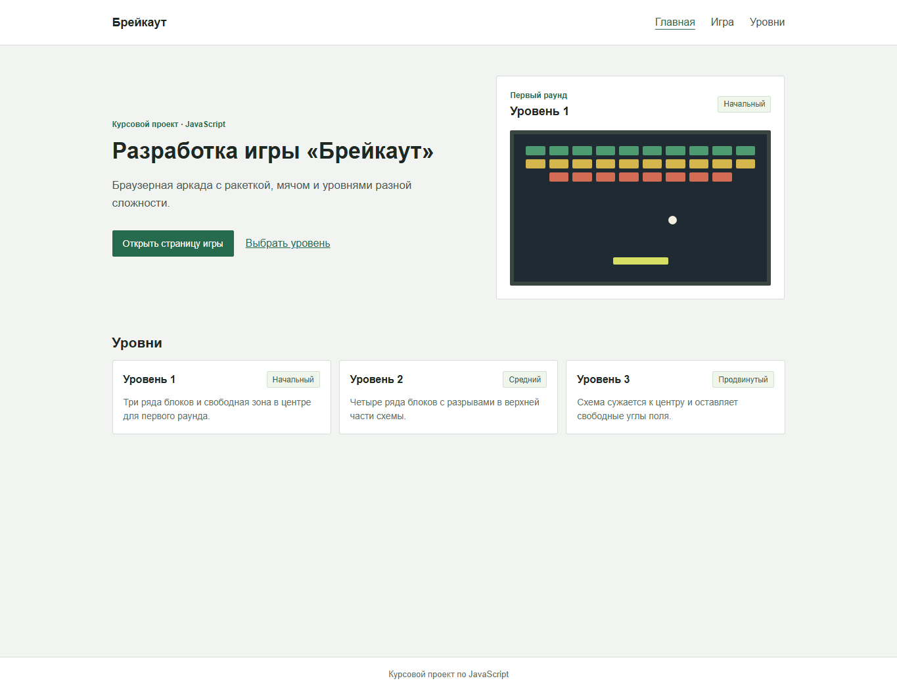
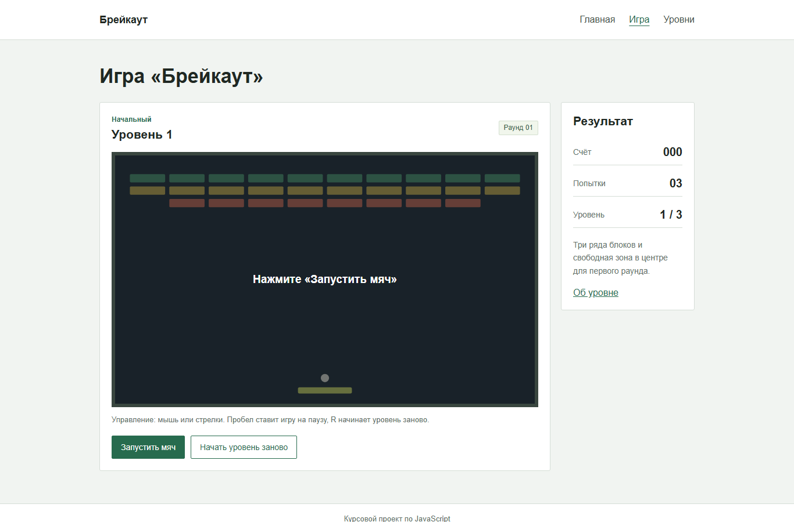

# Брейкаут

Учебный проект по теме «Разработка игры „Брейкаут“ с уровнями и моделью физики на языке JavaScript». В проекте реализована браузерная игра с тремя уровнями, управлением платформой, простыми отскоками мяча и подсчётом результата.

## Структура

- `apps/web` — браузерное приложение с главной страницей, страницей игры и страницей уровня.
- `packages/ui-components` — библиотека общих React-компонентов, используемая приложением.
- `apps/web/src/game/gameEngine.ts` — движение мяча, столкновения, очки и состояние уровня.
- `architecture.md` — проекты, компоненты, библиотеки и маршруты.
- `mvp.md` — сценарий использования и границы первой версии игры.

## Требования

- Node.js 20.19 или новее.
- npm 10 или новее.

## Запуск

Из корня репозитория установите зависимости и соберите проекты:

```sh
npm install
npm run build
```

Запустите приложение:

```sh
npm run dev
```

Vite напечатает локальный адрес приложения. Основные команды из корня:

```sh
npm run lint
npm run test
npm run test:coverage
npm run build
```

Оба проекта также имеют собственные команды `dev`, `build`, `lint`, `lint:fix`, `test` и `test:coverage`. Чтобы запустить команду для одного проекта, используйте `npm run <команда> --workspace @breakout/web` или `npm run <команда> --workspace @breakout/ui-components`.

## Примеры интерфейса

Главная страница:



Игровой раунд:



Снимки показывают главную страницу и игровое поле.

## Игра

На `/game` открывается первый уровень. Уровень можно выбрать со страницы уровня или указать в адресе, например `/game?levelId=2`. Нажмите «Запустить мяч», чтобы начать раунд.

- Перемещайте платформу мышью или стрелками влево и вправо. Также работают клавиши `A` и `D`.
- Пробел запускает мяч или переключает паузу.
- Клавиша `R` или кнопка «Начать уровень заново» перезапускает текущий уровень.
- За каждый разрушенный блок начисляется 10 очков.
- После разрушения всех блоков можно перейти к следующему уровню. Для прохождения игры нужно завершить все три.
- Если мяч проходит ниже платформы, теряется одна попытка. После последней попытки раунд завершается.

## Маршруты

- `/` — обзор проекта и переход к прототипу.
- `/game` — экран игры со схемой поля и показателями раунда.
- `/levels/:levelId` — описание выбранного уровня.
- остальные адреса — страница 404.

## Проверки

Модульные тесты проверяют игровую логику, управление, столкновения, счёт, попытки и завершение раунда, а также маршруты и компоненты интерфейса. Для игровой логики запускайте `npm run test:coverage --workspace @breakout/web`.
